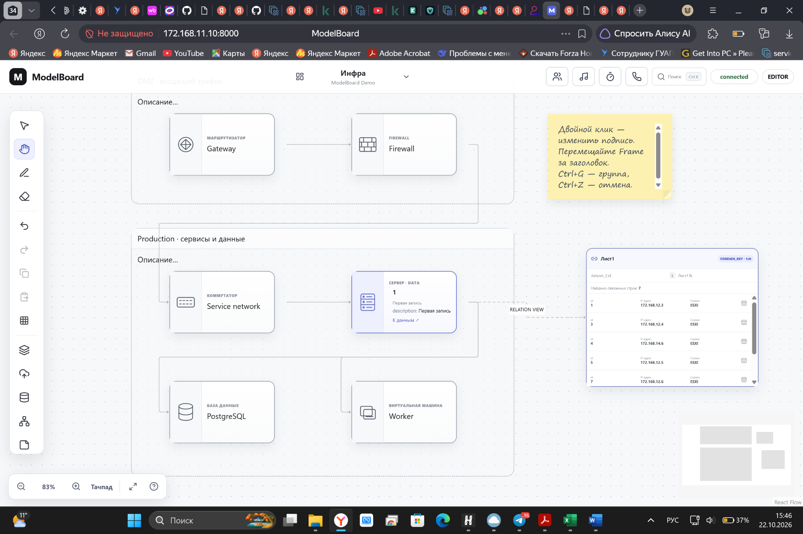
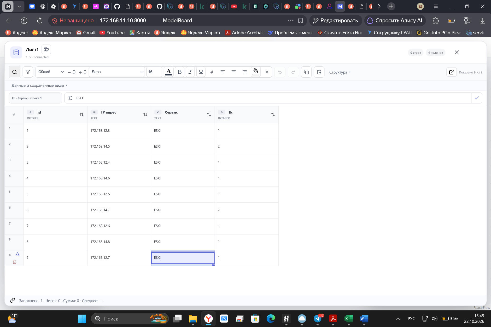
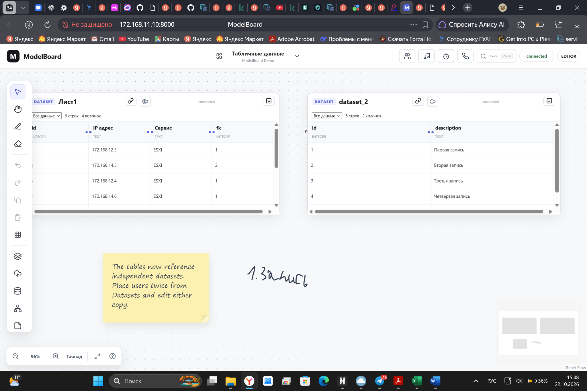
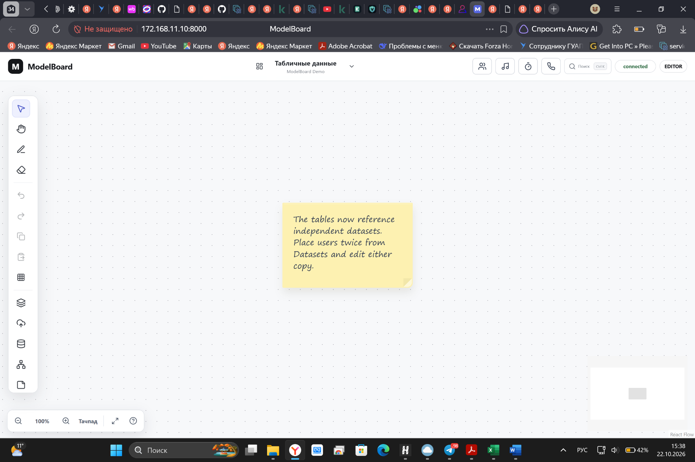

# ModelBoard

**Бесконечная доска, таблицы и связи между данными — в одном рабочем пространстве.**

[](https://github.com/Besstrawniy/modelboard/actions/workflows/ci.yml)

ModelBoard — веб-приложение для совместной работы со схемами и структурированными данными, которое можно развернуть на своём сервере. Здесь можно рисовать инфраструктуру, редактировать таблицы, связывать записи между собой и показывать их значения прямо на объектах доски.

Например, значок сервера можно привязать к строке таблицы, вывести на нём имя и IP-адрес, а рядом разместить список связанных виртуальных машин. Когда данные меняются, связанные представления обновляются у участников.

> Проект активно развивается и находится на стадии MVP. Основные сценарии уже реализованы; интерфейс, совместимость и модель доступа продолжают дорабатываться.



## Для каких задач

- **Инфраструктура:** схемы серверов, сетей, виртуальных машин и сервисов с привязкой к реестрам оборудования.
- **Системный анализ:** модели сущностей, связи таблиц, описание зависимостей и обсуждение изменений на одной доске.
- **Командная работа:** совместные схемы, заметки, комментарии и презентация отдельных областей доски.
- **Учебные стенды:** визуальное описание лабораторной среды и работа с её данными в браузере.

## Возможности

| Область | Что можно делать |
| --- | --- |
| Доска | Добавлять фигуры, текст, стикеры и стрелки; рисовать пером; создавать группы и вложенные Frame |
| Редактирование | Перемещать, поворачивать и выравнивать объекты, менять оформление, управлять слоями, копировать и отменять действия |
| Таблицы | Работать с диапазонами, массовой вставкой, автозаполнением, фильтрами, сортировкой и сохранёнными видами |
| Формулы | Использовать A1-адресацию, диапазоны, относительные и абсолютные ссылки, русские и английские имена поддерживаемых функций |
| Оформление данных | Задавать числовые форматы, шрифты, цвета, выравнивание и условное оформление |
| Связи | Создавать отношения между таблицами, задавать кардинальности, проверять внешние ключи и просматривать связанные записи |
| Объекты и данные | Привязывать объекты к таблице, строке, колонке или ячейке; показывать поля, статусы и агрегаты |
| Совместная работа | Редактировать доски и таблицы вместе, видеть курсоры участников, оставлять комментарии |
| Импорт | Загружать CSV, TSV, XLSX и JSON с предпросмотром, добавлять изображения и пользовательские SVG |
| Экспорт | Выгружать таблицы в XLSX, CSV и JSON; переносить содержимое доски и данные через архив `.modelboard.json` |
| Навигация | Использовать несколько досок, искать данные и переходить от объекта к исходной записи |

Для совместных сессий доступны общий таймер, голосования, реакции, показ Frame с добровольным следованием за ведущим и фоновая музыка. Можно подключить собственную коллекцию аудиофайлов или прямую ссылку на трек.

## Как это выглядит

### Табличный редактор

Таблица открывается в отдельном редакторе со строкой формул, панелью оформления и управлением структурой. Одни и те же данные можно редактировать из разных представлений.



### Таблицы и связи на доске

Таблицы размещаются рядом со схемой. Связи между колонками задают отношения между наборами данных; из связанных записей можно создавать отдельные визуальные представления.



### Свободная доска

Доской можно пользоваться самостоятельно: рисовать, добавлять пояснения, объединять объекты в группы и Frame, перемещаться по рабочему пространству и обсуждать схему с коллегами.



Все четыре скриншота в README сняты в работающем приложении.

## Главная идея: данные существуют отдельно от схемы

**Dataset** — самостоятельный набор данных с колонками и строками. **Board** — доска с визуальными объектами. Таблица на доске показывает Dataset, а объект может ссылаться на конкретную запись или значение.

Поэтому один Dataset можно разместить несколько раз, в том числе на разных досках. Редактирование значения обновляет связанные представления без ручного копирования. Привязки используют устойчивые идентификаторы строк и колонок: изменение IP-адреса или названия не меняет личность записи.

Пример рабочего процесса:

1. Импортировать таблицы серверов и виртуальных машин.
2. Связать поле `machines.server_id` с `servers.id`.
3. Разместить на доске объекты серверов и привязать их к строкам `servers`.
4. Показать на объектах hostname, IP и статус, а рядом — связанные ВМ.
5. Редактировать данные и схему совместно с другими участниками.

## Запуск на своём сервере

Нужны **Git, Docker Engine и Docker Compose plugin** с поддержкой `up --wait`. Для первого запуска:

```bash
git clone https://github.com/Besstrawniy/modelboard.git
cd modelboard
cp .env.server.example .env.server
```

Заполните `.env.server`:

| Параметр | Что указать |
| --- | --- |
| `POSTGRES_PASSWORD` | Пароль новой БД; для существующей установки сохраните действующее значение |
| `JWT_SECRET` | Отдельный случайный секрет, минимум 32 символа |
| `OWNER_PASSWORD` | Пароль владельца, минимум 12 символов |
| `WEB_ORIGIN` | Адрес участников, например `http://192.168.1.50:8080` |
| `WEB_PORT` | Порт сайта, по умолчанию `8080` |

Для генерации случайных значений можно использовать `openssl rand -hex 32`. Для каждого секрета сгенерируйте отдельное значение.

```bash
docker compose --env-file .env.server -f docker-compose.server.yml up -d --build --wait
```

Откройте `http://IP_СЕРВЕРА:8080` или адрес с выбранным портом. Вход владельца — **`owner@example.local`**, пароль — заданный `OWNER_PASSWORD`.

Web, REST API и WebSocket доступны через один адрес. PostgreSQL хранит данные в Docker volume; миграции применяются при запуске API.

Подробности запуска, обновления, резервного копирования и настройки HTTPS: **[серверная инструкция](docs/SERVER_RU.md)**. Текущий вариант рассчитан на локальную сеть/VPN; для доступа через Интернет нужен HTTPS.

### Роли и учётные записи

В серверном режиме используются четыре общие учётные записи с отдельными паролями:

| Вход | Роль | Возможности | Пароль из `.env.server` |
| --- | --- | --- | --- |
| `owner@example.local` | `OWNER` | Редактирование; удаление досок | `OWNER_PASSWORD` |
| `editor@example.local` | `EDITOR` | Редактирование доски и данных | `EDITOR_PASSWORD` |
| `commenter@example.local` | `COMMENTER` | Просмотр и комментарии | `COMMENTER_PASSWORD` |
| `viewer@example.local` | `VIEWER` | Просмотр | `VIEWER_PASSWORD` |

Для необязательных учётных записей пустой пароль отключает вход. Каждый заданный пароль должен содержать минимум 12 символов. Права проверяются сервером. Персональные аккаунты и панель управления участниками пока не реализованы.

## Локальная разработка

Нужны **Node.js 22+, npm 10+, Docker и Docker Compose**.

```bash
git clone https://github.com/Besstrawniy/modelboard.git
cd modelboard
cp .env.example .env
docker compose up -d postgres
npm install
npm run dev
```

Интерфейс откроется на `http://localhost:5173`. В локальном режиме разработки доступен демонстрационный выбор пользователя. Парольный режим можно включить через `AUTH_MODE=password`; параметры описаны в [серверной инструкции](docs/SERVER_RU.md).

Подробная установка и диагностика: **[INSTALL_RU.md](docs/INSTALL_RU.md)**.

## Технологии и устройство проекта

| Часть | Технологии | Каталог |
| --- | --- | --- |
| Интерфейс | TypeScript, React, Vite, React Flow | `apps/web` |
| REST API и проверка доступа | NestJS, JWT | `apps/api` |
| Совместное редактирование | Yjs, Hocuspocus, WebSocket | `apps/collab` |
| Хранение и миграции | PostgreSQL | `packages/db` |
| Общие типы и логика | Формулы, связи, документы доски | `packages/shared` |
| Серверный запуск | Docker Compose, Nginx | `docker-compose.server.yml`, `deploy` |

Состояние совместных документов сохраняется в PostgreSQL. Изменения таблиц также проецируются в реляционные данные для работы API и связей.

## Документация

- [Запуск общего сервера и доступ по сети](docs/SERVER_RU.md)
- [Установка и локальная разработка](docs/INSTALL_RU.md)
- [Доска и горячие клавиши](docs/CANVAS_GUIDE_RU.md)
- [Таблицы, формулы и оформление](docs/SPREADSHEET_GUIDE_RU.md)
- [Объекты, привязки и связи между таблицами](docs/RELATIONS_GUIDE_RU.md)
- [Импорт и экспорт файлов](docs/FILES_GUIDE_RU.md)
- [Совместные сессии и инструменты команды](docs/COLLABORATION_GUIDE_RU.md)
- [Принципы привязки объектов к данным](docs/OBJECT_BINDINGS.md)
- [План развития](docs/ROADMAP.md)

## Проверки

```bash
npm run typecheck
npm test
npm run build
```

Браузерные сценарии запускаются командой `npm run test:e2e`; для них нужны PostgreSQL и установленный Chromium для Playwright.

GitHub Actions также собирает серверный Docker-набор и проверяет его двумя независимыми браузерами: вход и права, обычный HTTP, создание объектов, размещение таблиц и совместное редактирование через WebSocket.

## Текущие границы проекта

- Персональная регистрация, восстановление пароля и управление участниками через интерфейс находятся в планах.
- Управление несколькими рабочими пространствами через UI и полноценная история версий досок пока не реализованы.
- Поддерживается собственный набор формул и возможностей XLSX; полная совместимость с Excel не заявляется.
- Созвоны представлены общей ссылкой на внешнюю встречу и готовностью участников; встроенная передача аудио, видео и экрана пока не реализована.
- Текущий серверный вариант использует один процесс совместного редактирования; масштабирование на несколько реплик требует отдельной доработки.

Этапы развития: **доска → таблицы → связи и объекты → работа с файлами и дополнительные инструменты**. Реализованные сценарии поддерживаются, дальнейшие задачи и критерии качества собраны в [роадмапе](docs/ROADMAP.md).

## Участие в разработке

Сообщайте об ошибках и предлагайте улучшения через [Issues](https://github.com/Besstrawniy/modelboard/issues). Для воспроизведения полезны шаги, ожидаемый и фактический результат, версия браузера и скриншот. Изменения кода можно предлагать через Pull Request с описанием задачи и выполненных проверок.

## Лицензия

Лицензия проекта пока не выбрана; отдельный файл `LICENSE` ещё не добавлен.
